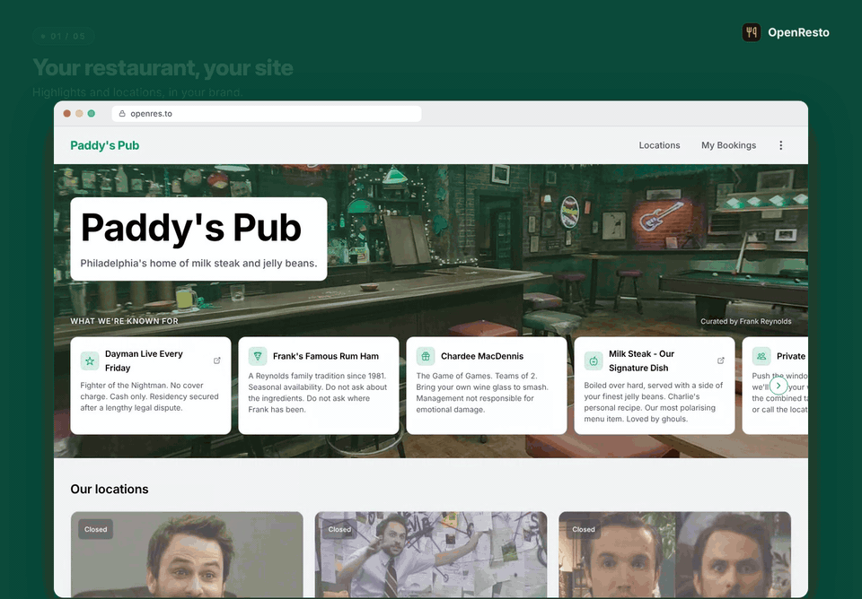
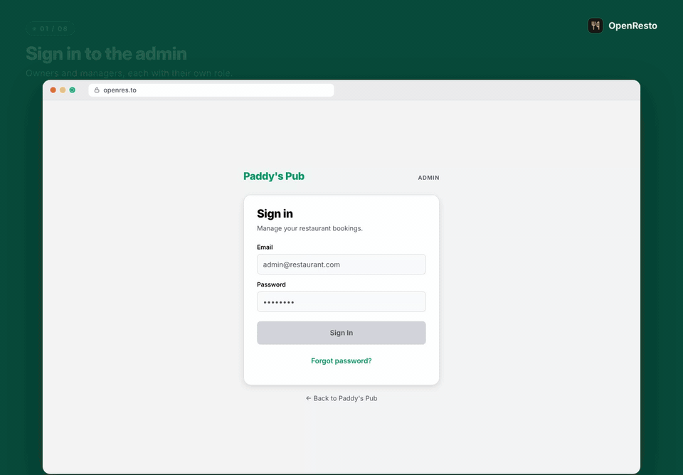
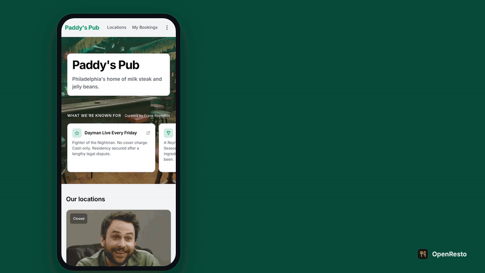
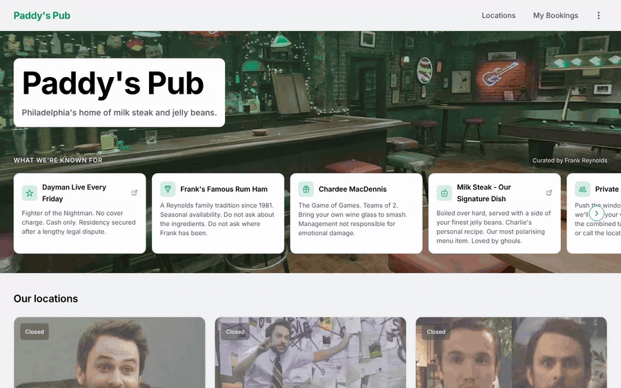
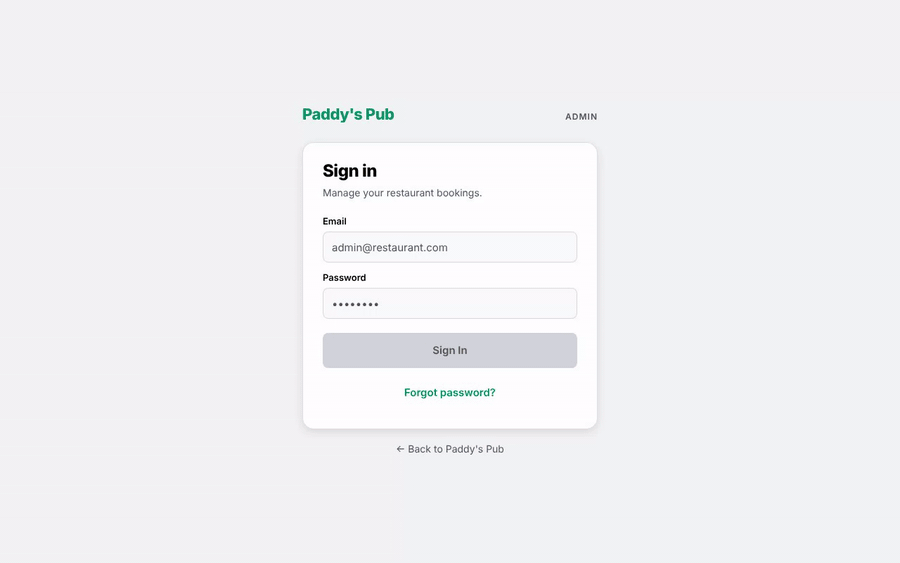

# OpenResto

[](https://github.com/karanshukla/openresto/releases/latest)
[](https://github.com/karanshukla/openresto/actions/workflows/ci.yml)
[](https://coveralls.io/github/karanshukla/openresto)
[](https://www.zaproxy.org/)
[](https://dotnet.microsoft.com/)
[](https://expo.dev/router)
[](https://www.docker.com/)
[](https://github.com/karanshukla/openresto/pkgs/container/openresto-backend)
[](https://github.com/karanshukla/openresto)
[](https://opensource.org/licenses/MIT)
[](https://github.com/karanshukla/openresto)
[](https://github.com/karanshukla/openresto)
[](https://claude.ai/code)

A self-hosted, zero-dependency restaurant booking system. Guests browse restaurants, hold tables in real time, and book without creating an account. Admins manage reservations, tables, floor sections, branding, and booking pauses from a web dashboard. Everything runs from a single Docker Compose command with no external services required beyond optional SMTP.

**[Documentation](https://docs.openres.to)** · **[Live Demo](https://openres.to)** - admin: `example@example.com` / `password` · resets every 2 hours, feel free to play around and change anything

## Philosophy

The restaurant business has changed. Indie restaurants run on razor-thin margins, and the cost of SaaS booking platforms only adds to the burden. Users don't want to install another app, give up their phone number to the cloud, or create another account to remember. OpenResto was designed to be as simple as possible for both customers and restaurant owners, while still being fully self-hosted, secure, and customisable. Owners can manage bookings easily without friction. Customers book instantly without giving up any personal information, and can easily save their reservations to their calendar. Nothing in between.

## See it in action

These recordings show the real app, captured with Playwright against the [live demo](https://openres.to) and its seed dataset. The framed recordings include step captions; plain recordings are collapsed underneath.

### Booking a table

Browse locations, pick a party size, date, and time, and hold the table while entering guest details. The confirmation page includes calendar export, reminders, and directions.



### Running the restaurant

Sign in to the dashboard, open the day's timetable and booking details, switch to the service view, review a location's policies, hours, and tables, and edit branding with a live preview.



### On a phone

The same site works on mobile browsers with nothing to install.



<details>
<summary><strong>Plain recordings</strong> (no frame, no captions)</summary>

<br>

**Desktop**





**Phone and tablet**

<table>
  <tr>
    <td valign="top"></td>
    <td valign="top"></td>
  </tr>
</table>

</details>

## Tech Stack

| Layer        | Technology                                                                           |
| ------------ | ------------------------------------------------------------------------------------ |
| Backend      | ASP.NET Core 10, C#, Entity Framework Core, SQLite                                   |
| Frontend     | React Native (Expo Router) for web and mobile from one codebase                      |
| Auth         | JWT Bearer Tokens (HS256), encrypted HttpOnly cookies                                |
| Image gen    | Magick.NET-Q8-AnyCPU (cross-platform, no native deps)                                |
| Email        | MailKit (SMTP)                                                                       |
| Infra        | Docker Compose, Nginx reverse proxy                                                  |
| Security CI  | OWASP ZAP API scan on every push (OpenAPI-driven, rules in `.github/.zap-rules.tsv`) |
| Code mappers | Mapperly (source-gen, zero reflection)                                               |

## Quick Start

### Self-hosted install (pre-built images, recommended for production)

Download `docker-compose.yml` from the [latest release](https://github.com/karanshukla/openresto/releases/latest), create a `.env` file based on [`.env.example`](.env.example), and start the stack:

```bash
docker compose up -d
```

Pre-built `linux/amd64` and `linux/arm64` images are pulled from GHCR with no build step, so they run directly on a VPS, Raspberry Pi, or NAS. The backend applies pending database migrations automatically before accepting traffic.

- Full self-hosting guide (install, configuration, HTTPS, email, upgrading, troubleshooting): [docs.openres.to](https://docs.openres.to/self-hosting/installation/)
- Backup and restore: [backup and restore guide](https://docs.openres.to/self-hosting/backup-restore/)
- Admin API keys and HTTP usage: [API guide](https://docs.openres.to/api/authentication/)
- Publishing a branded iOS/Android guest app: [native app guide](https://docs.openres.to/guides/native-app/)

### Docker (build from source)

For local development:

```bash
docker compose up
```

- App: http://localhost:5062
- API: http://localhost:8080
- Frontend dev: http://localhost:8081

### Local Development

**Prerequisites:** .NET 10 SDK, Node.js 20+

```bash
# run from the repo root
npm run dev
```

The SQLite database is created automatically on first run. Because this runs outside Docker, uploaded images and media are not served through the proxy, though HMR is enabled.

## Configuration

### Backend

Set via environment variables or `appsettings.json`:

| Variable            | Description                     | Default                      |
| ------------------- | ------------------------------- | ---------------------------- |
| `JWT_KEY`           | JWT signing key (min 32 chars)  | Dev key in appsettings       |
| `CONNECTION_STRING` | SQLite connection string        | `Data Source=./openresto.db` |
| `CORS_ORIGINS`      | Comma-separated allowed origins | localhost ports              |
| `Admin:Email`       | Default admin email             | Set in appsettings           |
| `Admin:Password`    | Default admin password          | Set in appsettings           |

Optional integrations use the same mechanism and remain disabled until configured. Apple and Google Wallet passes (`Wallet__Apple__*`, `Wallet__Google__*`) and guest booking reminders (`Vapid__*` on the web, an EAS project on native) hide their UI buttons while unset. When running from a clone, put local settings in `OpenRestoApi/appsettings.Local.json` (loaded automatically when present and ignored by `.gitignore`). See the [native app guide](https://docs.openres.to/guides/native-app/) for Wallet issuer setup.

The API Keys settings screen links to the CLI package, the HTTP API guide, and the source repository. These three URLs default to this project and can be overridden per deployment with `OPENRESTO_CLI_PACKAGE_URL`, `OPENRESTO_API_DOCS_URL`, and `OPENRESTO_REPOSITORY_URL` (or the configuration keys `Links:CliPackage`, `Links:ApiDocs`, and `Links:Repository`), which is useful for forks with their own client or docs.

### Frontend

| Variable              | Description          | Default                 |
| --------------------- | -------------------- | ----------------------- |
| `EXPO_PUBLIC_API_URL` | Backend API base URL | `http://localhost:5062` |

VAPID key variables are also required for web push notifications, but are optional during local development.

## Testing

```bash
# Backend tests
dotnet test

# Frontend tests (100% coverage target)
cd openresto-frontend && npm test

# Full frontend coverage report
cd openresto-frontend && npm test -- --coverage
```

Note: VSCode may not detect the Jest config until you enable the test runners from the command palette.

## Key Features

### Booking flow

- **Real-time table holds:** Selecting a time slot places a 5-minute hold on the specific table in a thread-safe in-memory `ConcurrentDictionary`. The client echoes `holdId` when submitting the booking, preventing another guest from booking the same table during checkout. Holds expire automatically and release atomically if the guest changes their selection.
- **Popular-times categorisation:** Every 30-minute slot is tagged `Lunch`, `Dinner`, or `Off-Peak` based on restaurant industry benchmarks (Toast, Square, Yelp). The frontend groups available slots into labelled tabs so guests can jump to a service period.
- **IANA timezone awareness:** All `DateTime` values are stored in UTC. Restaurant open/close hours and slot generation are computed in the restaurant's IANA timezone (`America/New_York`, `Europe/London`, etc.), so availability matches local time regardless of the server timezone.

### Admin & management

- **Multi-restaurant support:** Manage multiple locations from one instance, each with its own tables, sections, hours, timezone, and branding.
- **Floor sections:** Group tables into named sections (such as "Patio", "Bar", or "Main") so admins can organize seating and guests can see which section they are booking.
- **Admin dashboard:** View live bookings with status filtering (active, past, cancelled), extend or cancel reservations, and track customer names for front-of-house staff.
- **Booking pauses:** Pause new reservations until a specific date and time (for example, during a private event) without taking the restaurant offline or editing config files. The availability API checks `BookingsPausedUntil` before returning slots.
- **Activity trail:** Every state-changing admin action, sign-in, and failed sign-in attempt is recorded in an append-only log with actor, timestamp, IP address, and before/after diff. Any mutating request behind an admin policy is audited automatically, including newly added endpoints. Only Owners can read the log, and there is no delete endpoint; entries are removed only by a configurable retention job (365 days by default). Credentials and guest identities are masked so changes are recorded without storing sensitive values.
- **API keys & headless CLI:** Owners can create long-lived, individually revocable API keys under **Settings → API Keys**, scoped to specific resources (`bookings`, `locations`, `tables`, `brand`, `users`, `audit`, `guests`). A key without the `guests` scope reads bookings with customer identity redacted, keeping guest contact info out of POS or marketing integrations. [`openresto-cli`](openresto-cli/README.md) calls the same admin API from scripts and cron jobs with named profiles, `--json` output on every command, and confirmation prompts on destructive actions. Every API key request is recorded in the activity trail under the key's name.

### Branding & UI

- **Full white-label branding:** App name, primary color, favicon icon, and PWA identity are stored in the database and configured in the admin settings panel. Choose from 15 Lucide icons (`utensils`, `wine`, `coffee`, `pizza`, `flame`, `leaf`, `star`, `heart`, `chef-hat`, `fish`, `hamburger`, `sandwich`, `soup`, `cake`, `ice-cream-cone`); the browser tab favicon updates live without a page reload. The frontend fetches brand settings on startup and applies them through `BrandContext`.
- **Dynamic PWA icons:** `GET /api/brand/pwa-icon.svg` generates an SVG with the brand background color and white icon dynamically. `GET /api/brand/pwa-icon-{192|512}.png` rasterizes it with Magick.NET (cross-platform, no system ImageMagick package required) for PWA manifest compliance.
- **Skeleton loaders & splash screens:** Branded loading states across the app avoid blank white flashes.

### Security & privacy

- **OWASP ZAP API scan in CI:** Every push runs a ZAP API scan against the full Docker stack, discovering endpoints from the OpenAPI spec (`/openapi/v1.json`). Ignored rules are tracked in `.github/.zap-rules.tsv`.
- **Rate limiting:** Uses ASP.NET Core built-in rate limiting on sensitive endpoints.
- **Encrypted recent-bookings cookie:** Stores recent reservation references in an HttpOnly cookie protected by ASP.NET Core Data Protection so guests can look up recent bookings without an account.
- **Hard-delete:** Admins can permanently erase booking records for GDPR compliance. A GDPR notice is shown on the booking form.
- **No accounts needed:** Guests look up reservations with a short `BookingRef` code and their email, with no email verification loop.
- **Publish your own guest app:** Build the same guest screens as a native iOS and Android app under your own store accounts, pointed at your own instance. Run `npm run native:init` to pull your branding and build with `eas build` ([native app guide](https://docs.openres.to/guides/native-app/)).

### Developer experience

- **Single-command dev:** `npm run dev` starts the .NET backend (with hot reload) and Expo frontend concurrently.
- **100% frontend coverage target:** Uses Jest and React Native Testing Library, plus Playwright E2E tests against the Docker stack.
- **Mapperly source-gen mappers:** Generates DTO mappings at compile time with zero runtime reflection.
- **Self-hosted:** Runs on any VPS, Raspberry Pi, or NAS with Docker and SQLite, with no managed database or CDN required.
- **Auto-migrations on startup:** The backend runs `Database.Migrate()` before accepting traffic; upgrading is `docker compose pull && docker compose up -d`.
- **Migration safety CI:** Every PR that adds an EF Core migration generates SQL for both a fresh install and an upgrade from the previous state, applies both to SQLite, and verifies the resulting schemas match.
- **Multi-arch releases:** Publishes `linux/amd64` and `linux/arm64` images to GHCR on every semver tag for native x86 and ARM support.

## Cutting a release

1. **Update `CHANGELOG.md`:** Add a `## [x.y.z] - YYYY-MM-DD` section at the top of the file.
2. **Merge to main:** Confirm all CI checks are green before tagging.
3. **Tag and push:**

   ```bash
   git tag v1.0.0
   git push origin v1.0.0
   ```

4. **Automated release:** The [`release.yml`](.github/workflows/release.yml) workflow runs automatically and:
   - Builds `linux/amd64` and `linux/arm64` Docker images for the backend, frontend, and nginx proxy
   - Pushes them to GHCR as `ghcr.io/karanshukla/openresto-{backend,frontend,nginx}:v1.0.0` (and `:latest`)
   - Creates a GitHub Release using the `[x.y.z]` section from `CHANGELOG.md` as release notes
   - Attaches a pinned `docker-compose.yml` (with the exact image tag baked in) as a downloadable release asset for self-hosters

## License

MIT, do what you want with it
